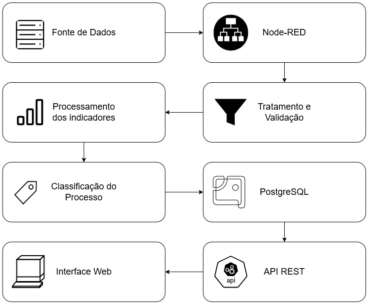

# Sistema de Monitoramento do Pré-Aquecimento de Água Industrial

**Protótipo acadêmico de monitoramento industrial | Node-RED · Raspberry Pi · PostgreSQL · API REST · Dashboard Web**

Projeto desenvolvido como Trabalho de Conclusão de Curso (TCC) em **Sistemas de Informação — UNIDAVI (2026)**, por **Jean Koerich**.

## Visão geral

O projeto investiga como transformar leituras de um processo de **pré-aquecimento de água por aproveitamento térmico solar em ambiente industrial** em informações que possam ser acompanhadas e consultadas posteriormente.

A solução implementa uma **camada de software para monitoramento**, com geração de dados simulados, tratamento e validação das leituras, cálculo de indicadores, classificação operacional, persistência no PostgreSQL e visualização em uma interface web.

> **Escopo desta versão:** o fluxo opera com **dados simulados no Node-RED**. Existe um adaptador de entrada para dados de CLP virtual, mas a aquisição efetiva de um CLP e os sensores físicos **não foram integrados nem validados**. O sistema monitora e classifica informações; **não comanda válvulas nem controla a planta física**.

## Arquitetura



O processamento foi distribuído em cinco etapas principais:

`Entrada → Pré-processamento → Processamento → Classificação → Persistência`

Após a gravação no PostgreSQL, uma **API REST independente** disponibiliza os registros para o dashboard. Na implantação documentada no TCC, o **Nginx** hospeda a interface e encaminha `/api/` ao Node-RED.

[**Entenda a arquitetura, as funções e o fluxo dos dados**](docs/arquitetura.md)

## Funcionalidades implementadas

| Área | O que o protótipo demonstra |
| --- | --- |
| **Simulação de processo** | Quatro estados: `RECARREGANDO`, `AQUECENDO`, `MATURANDO` e `TRANSFERINDO`; geração nominal de uma amostra a cada 60 segundos. |
| **Tratamento de dados** | Normalização de campos, conversão de tipos, padronização das válvulas e validação de consistência. |
| **Indicadores** | Diferença de temperatura (ΔT), vazão, volume, energia térmica estimada, acumulados diários, desempenho térmico percentual e economia financeira estimada. |
| **Classificação** | Estado operacional, condição térmica, condição de transferência, posição das válvulas e criticidade. |
| **Banco de dados** | Histórico de leituras em `public.leitura_monitoramento`, com `INSERT` parametrizado. |
| **API REST** | Consulta da leitura mais recente, das últimas 20 leituras e de até 100 pontos do histórico. |
| **Interface web** | Acompanhamento dos indicadores, últimas leituras e evolução das temperaturas, com atualização periódica via API. |
| **Continuidade operacional** | Execução em Raspberry Pi e recuperação de contexto em armazenamento local, quando configurado no runtime. |

### API REST

| Método | Endpoint | Finalidade |
| --- | --- | --- |
| `GET` | `/api/status` | Leitura mais recente armazenada. |
| `GET` | `/api/ultimas-leituras` | Até 20 registros recentes. |
| `GET` | `/api/historico` | Até 100 registros recentes, apresentados em ordem cronológica. |

As rotas são atendidas pelo Node-RED e consultam o PostgreSQL; o navegador não acessa o banco diretamente.

## Tecnologias

- **Raspberry Pi 5 / Linux:** execução local dos serviços, com administração remota por SSH.
- **Node-RED / JavaScript:** simulação, integração, tratamento e classificação das mensagens.
- **PostgreSQL / SQL:** armazenamento e recuperação do histórico.
- **HTML, CSS e JavaScript:** interface de visualização.
- **Nginx:** servidor web e proxy reverso para a API na implantação do TCC.
- **JSON / HTTP REST:** contrato de comunicação entre a API e o dashboard.

## Evidências de validação

No período de testes documentado no TCC (**05/09/2026 a 21/10/2026**), foram armazenadas **61.238 leituras** com cadência nominal de aproximadamente um minuto.

A validação descrita no trabalho incluiu o fluxo integrado **Node-RED → PostgreSQL → API → Nginx → dashboard**, reinicialização do Raspberry Pi com retorno automático dos serviços e utilização do sistema em outra rede sem alteração do endereço da API no frontend.

Em **23/11/2026**, foram novamente verificadas as três rotas REST, a gravação de novas leituras e a recuperação do acumulador do F5 após reinicialização controlada do Node-RED com `contextStorage` em `localfilesystem`.

Esses resultados validam o **funcionamento da camada de software** em ambiente de simulação; **não representam validação experimental da eficiência de um sistema solar industrial real**.

## Organização do repositório

```text
.
├── README.md
├── node-red/
│   ├── flows/            # Export dos fluxos do Node-RED
│   └── functions/        # Cópias JavaScript das funções
├── database/             # Scripts de estrutura e consultas SQL
├── web/                  # Dashboard HTML/CSS/JavaScript
└── docs/
    ├── arquitetura.md    # Arquitetura, etapas e contratos
    └── imagens/          # Diagramas revisados para o portfólio
```

Os arquivos `.js` em `node-red/functions/` facilitam a leitura e a revisão. O artefato para importação no Node-RED é `node-red/flows/flows.json`.

## Reproduzir o protótipo

A reprodução requer **Node-RED**, **PostgreSQL** e um servidor HTTP para o frontend; o Raspberry Pi é o ambiente utilizado no trabalho, mas a arquitetura de software pode ser avaliada em outro ambiente compatível.

1. Preparar um banco PostgreSQL de teste conforme o [guia do banco de dados](database/README.md).
2. Instalar os nós necessários no Node-RED, incluindo `node-red-contrib-postgresql` (versão `0.16.2` declarada no export analisado).
3. Importar `node-red/flows/flows.json` e configurar **localmente** as credenciais e conexões do PostgreSQL.
4. Executar o fluxo com a origem `simulado` e conferir novas leituras no banco.
5. Hospedar `web/` via HTTP, encaminhando `/api/` ao Node-RED na mesma origem para o funcionamento completo do dashboard.

### Modo demonstrativo

Sirva `web/` via HTTP e selecione **Recarregando**, **Aquecendo**, **Maturando** ou **Transferindo** para ver os indicadores e a visualização do processo com dados locais. O dashboard abre em **Dados Reais**. A tabela de últimas leituras e o gráfico de histórico dependem da API na mesma origem, inclusive quando um cenário local está selecionado.

## Limitações conhecidas

- **Dados sintéticos:** temperaturas, vazão, estados e eventos são simulados; não houve integração física validada com sensores ou CLP.
- **Estimativa energética:** o F5 considera vazão e ΔT positivos também em `RECARREGANDO`. Os valores de energia e economia **não devem ser interpretados como energia útil comprovadamente entregue ao tanque ou economia elétrica efetivamente medida**.
- **Desempenho térmico:** o percentual é baseado na razão entre ΔT e uma referência configurada; **não é uma medição de eficiência termodinâmica**.
- **Cadência e acumulados:** o cálculo assume intervalo fixo de 1 minuto e utiliza contexto local para os totais diários; a persistência depende da configuração do runtime.
- **Integração CLP:** há adaptação de mensagens no fluxo, mas não aquisição Siemens operacional conectada nesta versão.
- **Segurança:** as rotas GET do fluxo não possuem autenticação própria. **Não exponha Node-RED, PostgreSQL ou a API diretamente à internet** sem proteção adicional.

Os parâmetros do código versionado podem diferir de valores apresentados em versões anteriores da documentação acadêmica. Para reproduzir esta implementação, o **fluxo exportado é a referência de execução**.

## Documentação

- [Arquitetura técnica e fluxo de processamento](docs/arquitetura.md)
- [Requisitos e casos de uso](docs/requisitos.md)
- [Indicadores e premissas](docs/indicadores.md)
- [Contratos da API REST](docs/api.md)
- [Evidências de validação](docs/validacao.md)
- [Preparação e verificação do banco](database/README.md)
- `node-red/flows/flows.json` — definição importável dos fluxos.
- `web/` — implementação do dashboard.

## Contexto acadêmico e autoria

**Título do TCC:** *Desenvolvimento de um Sistema de Monitoramento de Pré-Aquecimento de Água Industrial*.

**Autor:** Jean Koerich — **UNIDAVI**, Bacharelado em Sistemas de Informação, 2026.

**Licença:** ainda não definida. A disponibilização do código para avaliação pública **não constitui concessão automática de permissão para redistribuição ou reutilização**. A licença deverá ser escolhida antes da publicação definitiva.
