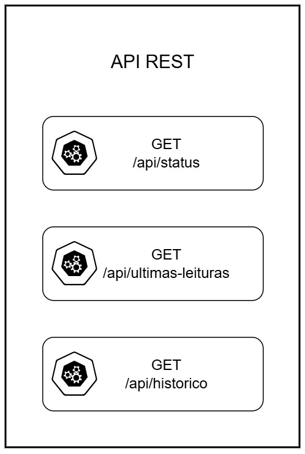

# API REST — contratos de consulta

A API REST é implementada em um subfluxo separado no **Node-RED**. Ela executa consultas SQL no **PostgreSQL** e retorna JSON para o dashboard web. Os exemplos abaixo representam o export revisado de `node-red/flows/flows.json` e utilizam **dados sintéticos**.



## 1. Contexto de execução

Na implantação documentada no TCC, o **Nginx** hospeda o dashboard e encaminha `/api/` ao Node-RED na porta interna `1880`. O frontend utiliza rotas relativas e não estabelece conexão direta com o PostgreSQL.

| Propriedade | Implementação atual |
| --- | --- |
| Protocolo | HTTP, requisições `GET` |
| Corpo das respostas | JSON |
| Origem dos dados | Tabela `public.leitura_monitoramento` no PostgreSQL |
| Autenticação nas rotas GET | **Não implementada no fluxo** |
| Parâmetros de paginação/filtro | **Não implementados** |
| Formato de timestamp | Gerado pelo banco/driver e serializado em JSON; nas leituras verificadas, ISO 8601 UTC (`Z`) |

> **Segurança:** as rotas não devem ser disponibilizadas na internet sem controles adicionais de acesso e rede. O código é de demonstração acadêmica e não deve ser interpretado como serviço de telemetria público ou pronto para produção.

## 2. `GET /api/status`

**Objetivo:** recuperar a leitura mais recente, usando `cd_leitura_monitoramento` em ordem decrescente.

**Consulta SQL:**

```sql
SELECT *
FROM public.leitura_monitoramento
ORDER BY cd_leitura_monitoramento DESC
LIMIT 1;
```

**Exemplo de resposta com registro:**

```json
{
  "sucesso": true,
  "dados": {
    "id": 1001,
    "origem": "simulado",
    "timestamp": "2026-11-23T13:44:59.921Z",
    "ciclo": 1,
    "estado_processo": "AQUECENDO",
    "status_operacional": "Aquecendo",
    "temperatura_entrada": 20.95,
    "temperatura_saida": 26.29,
    "delta_t": 5.34,
    "vazao_l_min": 0,
    "volume_instante_l": 0,
    "volume_total_l": 48,
    "valvula_entrada": "Fechada",
    "valvula_saida": "Fechada",
    "nivel_tubulacao_percentual": 100,
    "tempo_maturacao_min": 0,
    "energia_kj": 0,
    "energia_kwh": 0,
    "energia_total_kwh": 0.02107,
    "desempenho_termico_percentual": 35.6,
    "faixa_desempenho_termico": "Média",
    "economia_reais": 0.01,
    "condicao_termica": "Baixa",
    "condicao_transferencia": "Sem fluxo",
    "status_valvulas": "Ambas fechadas",
    "criticidade": "Normal",
    "fator_solar": 0.43,
    "observacao": "Aquecendo a água na tubulação",
    "validado": true,
    "status_validacao": "OK"
  }
}
```

O identificador e os valores são **ilustrativos**. A função de formatação converte campos numéricos para `number` ou `null`, conforme a disponibilidade do registro.

**Sem registros:**

```json
{
  "sucesso": false,
  "mensagem": "Nenhum registro encontrado"
}
```

Na implementação atual, `sucesso: false` sinaliza ausência de dados **dentro do JSON**; isso não significa necessariamente que a resposta tenha um código HTTP `404`.

## 3. `GET /api/ultimas-leituras`

**Objetivo:** retornar até **20 leituras**, da mais recente para a mais antiga, pela chave de registro.

**Consulta SQL:**

```sql
SELECT *
FROM public.leitura_monitoramento
ORDER BY cd_leitura_monitoramento DESC
LIMIT 20;
```

**Exemplo de resposta:**

```json
{
  "sucesso": true,
  "total": 2,
  "dados": [
    {
      "id": 1002,
      "timestamp": "2026-11-23T13:45:59.921Z",
      "origem": "simulado",
      "estado_processo": "AQUECENDO",
      "status_operacional": "Aquecendo",
      "temperatura_entrada": 21.12,
      "temperatura_saida": 27.01,
      "delta_t": 5.89,
      "vazao_l_min": 0,
      "energia_total_kwh": 0.02107,
      "desempenho_termico_percentual": 39.27,
      "economia_reais": 0.01,
      "criticidade": "Normal"
    },
    {
      "id": 1001,
      "timestamp": "2026-11-23T13:44:59.921Z",
      "origem": "simulado",
      "estado_processo": "AQUECENDO",
      "status_operacional": "Aquecendo",
      "temperatura_entrada": 20.95,
      "temperatura_saida": 26.29,
      "delta_t": 5.34,
      "vazao_l_min": 0,
      "energia_total_kwh": 0.02107,
      "desempenho_termico_percentual": 35.6,
      "economia_reais": 0.01,
      "criticidade": "Normal"
    }
  ]
}
```

**Sem registros:** `{ "sucesso": true, "total": 0, "dados": [] }`.

A rota **não retorna o campo `energia_kwh` instantâneo** na lista resumida, mesmo que ele exista em `/api/status` e no banco.

## 4. `GET /api/historico`

**Objetivo:** obter até **100 leituras recentes**, porém apresentadas em ordem cronológica crescente para construção do gráfico.

**Consulta SQL:**

```sql
SELECT *
FROM (
    SELECT *
    FROM public.leitura_monitoramento
    ORDER BY cd_leitura_monitoramento DESC
    LIMIT 100
) AS ultimas_leituras
ORDER BY cd_leitura_monitoramento ASC;
```

**Exemplo de resposta:**

```json
{
  "sucesso": true,
  "total": 2,
  "dados": [
    {
      "timestamp": "2026-11-23T13:44:59.921Z",
      "temperatura_entrada": 20.95,
      "temperatura_saida": 26.29,
      "delta_t": 5.34,
      "vazao_l_min": 0,
      "energia_total_kwh": 0.02107,
      "desempenho_termico_percentual": 35.6,
      "economia_reais": 0.01,
      "criticidade": "Normal"
    },
    {
      "timestamp": "2026-11-23T13:45:59.921Z",
      "temperatura_entrada": 21.12,
      "temperatura_saida": 27.01,
      "delta_t": 5.89,
      "vazao_l_min": 0,
      "energia_total_kwh": 0.02107,
      "desempenho_termico_percentual": 39.27,
      "economia_reais": 0.01,
      "criticidade": "Normal"
    }
  ]
}
```

**Sem registros:** `{ "sucesso": true, "total": 0, "dados": [] }`.

A API não aceita atualmente intervalo de datas, número de pontos configurável ou paginação. `LIMIT 100` refere-se à **quantidade de registros**, não a um período de 100 minutos garantido.

## 5. Teste local de consulta

Com Nginx configurado como proxy, as chamadas usam a origem HTTP que hospeda o frontend. Exemplo usando o próprio Raspberry Pi:

```bash
curl -fsS http://127.0.0.1/api/status | python3 -m json.tool
curl -fsS http://127.0.0.1/api/ultimas-leituras | python3 -m json.tool
curl -fsS http://127.0.0.1/api/historico | python3 -m json.tool
```

Caso o Nginx não esteja instalado ou configurado, o acesso direto ao Node-RED costuma utilizar a porta `1880`, por exemplo `http://127.0.0.1:1880/api/status`, **somente a partir do próprio equipamento ou rede autorizada**.

Para inspeção resumida sem alterar o banco:

```bash
curl -fsS http://127.0.0.1/api/status | python3 -c '
import json,sys
r=json.load(sys.stdin)
print(r.get("sucesso"), r.get("dados", {}).get("id"), r.get("dados", {}).get("timestamp"))
'
```

## 6. Tratamento de erros e limitações

- A ausência de dados é tratada pelo payload, conforme os exemplos acima.
- O export analisado **não implementa autenticação por endpoint, paginação, filtros, limites variáveis ou documentação OpenAPI**.
- Não existe, neste documento, evidência suficiente para garantir códigos HTTP específicos e um contrato uniforme para falhas de conexão com o PostgreSQL; esses cenários exigem teste adicional.
- As rotas dependem da estrutura `public.leitura_monitoramento` e de credenciais de banco configuradas localmente no Node-RED.
- A API expõe os **indicadores calculados pelo modelo simulado**; sua publicação como código não autoriza expor uma instalação operacional real.

## 7. Fontes e documentos relacionados

- Export de referência: `node-red/flows/flows.json`, Functions da API F1 a F6.
- TCC de Jean Koerich (2026), seções 4.17 e 4.18.
- [Arquitetura](arquitetura.md) · [Indicadores](indicadores.md) · [Validação](validacao.md)
