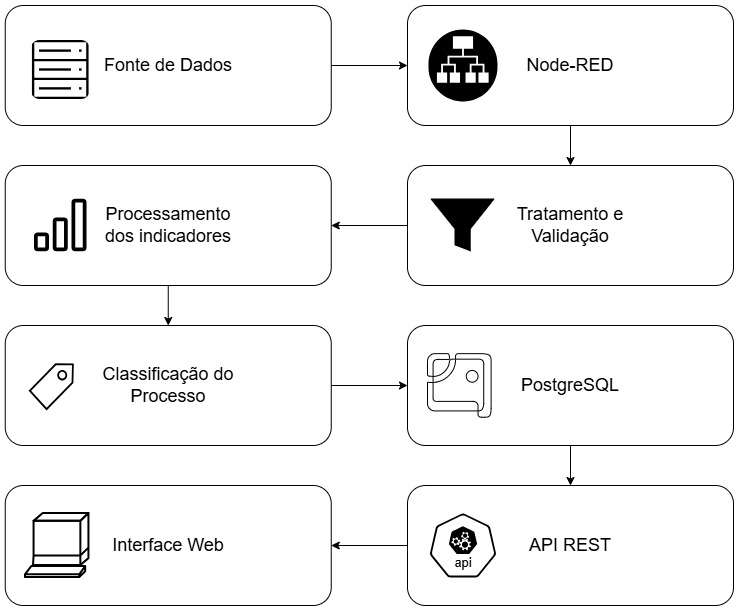
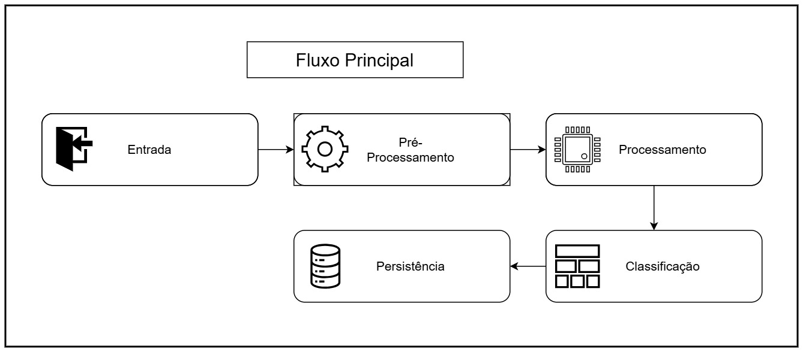
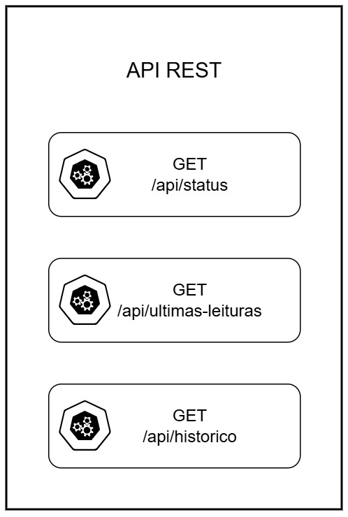
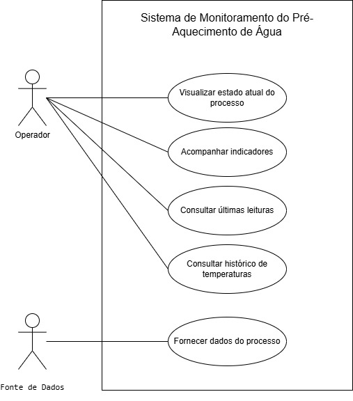

# Arquitetura do sistema

Este documento descreve a **implementação atual** do Sistema de Monitoramento do Pré-Aquecimento de Água Industrial. A referência técnica é o export `node-red/flows/flows.json`, confrontado com o TCC (2026) e os testes executados no Raspberry Pi.

A arquitetura segue o princípio de **separar entrada, processamento, persistência e apresentação**. O sistema monitora variáveis do processo e identifica inconsistências; **não realiza controle físico de válvulas ou equipamentos**.

## 1. Visão geral



| Camada | Responsabilidade | Tecnologia |
| --- | --- | --- |
| Fonte de dados | Gerar leituras sintéticas; permitir futura adaptação de mensagens de CLP | Node-RED, JavaScript |
| Aplicação | Normalizar, validar, calcular e classificar | Node-RED (`Function`) |
| Persistência | Manter leituras históricas e indicadores calculados | PostgreSQL |
| Integração de leitura | Expor dados processados em JSON | API REST no Node-RED |
| Apresentação | Visualização periódica do estado e histórico | HTML, CSS, JavaScript |
| Hospedagem local | Servir frontend e encaminhar `/api/` | Nginx no Raspberry Pi |

Na instalação documentada no TCC, Node-RED, PostgreSQL e Nginx são executados no **Raspberry Pi 5**. O acesso administrativo é realizado por SSH. Essa escolha mantém o processamento e o histórico na rede local, sem exigir serviços de nuvem para o fluxo principal.

## 2. Fluxo principal no Node-RED



```text
Inject (intervalo nominal de 60 s)
    │
    ▼
Entrada (F0 → seletor)
    ├── F1: simular dados [origem ativa]
    └── F2: adaptar mensagem de CLP [sem aquisição conectada]
    │
    ▼
Pré-processamento
    ├── F3: normalizar estrutura
    └── F4: validar dados
    │
    ▼
Processamento
    ├── Tarifa de energia: acrescentar msg.preco_kwh
    └── F5: calcular indicadores
    │
    ▼
Classificação
    └── F6: classificar processo
    │
    ▼
Persistência
    ├── F7: preparar registro final
    ├── F8: preparar SQL parametrizado
    └── PostgreSQL: public.leitura_monitoramento
```

A **API REST Dashboard** é um subfluxo separado: ela lê o histórico já persistido, sem depender de mensagens originadas no fluxo de coleta no momento da consulta.

### 2.1 Entrada — F0, F1 e F2

O **F0** define a origem; na versão revisada, o valor padrão é `simulado`. Um nó `Switch` encaminha a mensagem para a função apropriada.

O **F1** produz temperatura de entrada e saída, vazão, estado das válvulas, nível da tubulação, tempo de maturação, ciclo, fator solar e observações. Ele simula uma máquina de estados:

| Estado | Válvula de entrada | Válvula de saída | Vazão no simulador |
| --- | --- | --- | --- |
| `RECARREGANDO` | Aberta | Fechada | Positiva; recarga da tubulação |
| `AQUECENDO` | Fechada | Fechada | Zero |
| `MATURANDO` | Fechada | Fechada | Zero |
| `TRANSFERINDO` | Aberta | Aberta | Positiva; transferência |

Na implementação revisada, **a amostra emitida descreve o estado executado naquele instante**. O próximo estado é salvo no contexto, evitando discrepâncias entre o estado informado e os valores de válvula/vazão. O ciclo avança na transição de `TRANSFERINDO` para a próxima recarga.

O **F2** adapta campos recebidos em `msg.payload` para o contrato comum. **Não existe, no export atual, um nó de aquisição Siemens conectado ao F2.** O adaptador não equivale a uma integração operacional com o CLP.

### 2.2 Pré-processamento — F3 e F4

O **F3** padroniza origem, timestamp, estado operacional, números, estados das válvulas e observação. Valores numéricos ausentes ou inválidos são representados como `null` para posterior validação.

O **F4** verifica campos obrigatórios, limites e consistência entre estado do processo, válvulas e vazão. Diferencia:

- `OK`: amostra válida;
- `ALERTA`: amostra processável com condição fora do esperado;
- `ERRO`: amostra bloqueada (`return null`), sem continuidade para o cálculo e persistência.

Exemplos: vazão indevida durante `AQUECENDO`, ausência de fluxo durante `TRANSFERINDO`, temperatura inválida ou válvulas incompatíveis com o estado.

### 2.3 Processamento — tarifa e F5

O nó **Tarifa de energia** define `msg.preco_kwh = 0.51`. O F5 utiliza essa tarifa; quando a mensagem não apresenta uma tarifa válida, há fallback de **R$ 0,52/kWh**.

Principais campos calculados:

| Campo | Significado | Regra atual |
| --- | --- | --- |
| `delta_t` | Diferença de temperatura | `max(0, T_saida − T_entrada)` |
| `volume_instante_l` | Volume do intervalo | `vazao_l_min × 1 minuto` |
| `volume_total_l` | Volume acumulado | Soma dos volumes do dia de processamento |
| `energia_kj` | Energia térmica estimada do intervalo | `massa_kg × 4,18 × ΔT`, quando vazão > 0,5 L/min |
| `energia_kwh` | Conversão de energia | `energia_kj / 3600` |
| `energia_total_kwh` | Energia térmica acumulada | Soma diária das energias calculadas |
| `desempenho_termico_percentual` | Índice relativo de desempenho | `ΔT / 15°C × 100`, limitado a 0–100% |
| `economia_reais` | Economia financeira *estimada pelo modelo* | `energia_total_kwh × tarifa` |

A massa é aproximada por **1 kg para cada litro de água**. O modelo adota **intervalo fixo de 1 minuto** por amostra.

**Limitação de interpretação:** atualmente a energia é calculada sempre que há vazão suficiente e ΔT positivo, inclusive durante `RECARREGANDO`. Portanto, `energia_total_kwh` **não é um medidor isolado da energia útil entregue ao tanque**, e `economia_reais` **não comprova economia financeira realizada**. O indicador de desempenho também não representa uma eficiência térmica experimental.

### 2.4 Classificação — F6

O F6 recebe a amostra já processada e produz campos como `status_operacional`, `condicao_termica`, `condicao_transferencia`, `faixa_desempenho_termico`, `status_valvulas` e `criticidade`.

**Limiares presentes na versão revisada do código:**

| Regra | Valor |
| --- | --- |
| Condição térmica baixa | Saída < 35 °C |
| Condição térmica moderada | 35 °C ≤ saída < 45 °C |
| Condição térmica adequada | 45 °C ≤ saída ≤ 60 °C |
| Condição térmica elevada | Saída > 60 °C |
| Criticidade de alta temperatura | Saída > 85 °C |
| Alerta na transferência | Saída < 40 °C |
| Baixo ganho térmico | ΔT < 2 °C em aquecimento ou maturação |
| Vazão mínima de referência | 0,5 L/min |

Esses valores **diferem de alguns limiares impressos no TCC**. A tabela acima documenta o `F6` no export revisado, sem modificar o código. Observe também que o simulador F1 limita a temperatura a 70 °C; por isso, o cenário de criticidade > 85 °C não é exercitado diretamente pela simulação padrão.

### 2.5 Persistência — F7 e F8

O **F7** monta um registro final com identificação, processo, métricas, classificações, dados auxiliares e resultado da validação.

O **F8** prepara um `INSERT` com **29 parâmetros posicionais** (`$1` a `$29`) para a tabela `public.leitura_monitoramento`. O uso de parâmetros evita concatenar valores diretamente no SQL e reduz o risco de injeção.

O banco armazena a leitura e os indicadores calculados. A tabela é identificada pela chave `cd_leitura_monitoramento`. O resultado de validação é persistido; o array temporário de alertas não é uma das 29 colunas gravadas pelo `INSERT` atual.

## 3. Modelo lógico e contrato de dados

Campos principais do payload normalizado e processado:

```json
{
  "origem": "simulado",
  "timestamp": "2026-11-23T13:44:59.921Z",
  "estado_processo": "AQUECENDO",
  "ciclo": 1,
  "temperatura_entrada": 20.95,
  "temperatura_saida": 26.29,
  "vazao_l_min": 0,
  "valvula_entrada": "Fechada",
  "valvula_saida": "Fechada",
  "nivel_tubulacao_percentual": 100,
  "tempo_maturacao_min": 0,
  "fator_solar": 0.43
}
```

**Exemplo ilustrativo**, sem dados de produção. O `timestamp` representa um instante UTC (`Z`); o processamento dos acumulados utiliza a data local do runtime.

O [guia do banco de dados](../database/README.md) descreve as opções de esquema mínimo e completo e as consultas de verificação.

## 4. API REST e dashboard



A API REST é executada no Node-RED e separada dos subfluxos responsáveis pela geração e pelo armazenamento.

| Rota | Consulta | Resultado |
| --- | --- | --- |
| `GET /api/status` | Última leitura por `cd_leitura_monitoramento` | `{ "sucesso": true, "dados": { ... } }` |
| `GET /api/ultimas-leituras` | Últimas 20 leituras, da mais recente à mais antiga | `{ "sucesso": true, "total": 20, "dados": [ ... ] }` |
| `GET /api/historico` | Até 100 leituras recentes, reordenadas cronologicamente | `{ "sucesso": true, "total": 100, "dados": [ ... ] }` |

Os números `20` e `100` representam **limites máximos**, não a garantia de existirem tantos registros. Na ausência de leitura, `/api/status` retorna `{ "sucesso": false, "mensagem": "Nenhum registro encontrado" }` no payload; os endpoints de lista podem retornar arrays vazios.

As consultas SQL estão qualificadas como `public.leitura_monitoramento`.

O dashboard utiliza **HTML, CSS e JavaScript** e consulta os endpoints periodicamente. Os cenários demonstrativos fornecem dados locais para os indicadores e a visualização do processo. A tabela de últimas leituras e o gráfico de histórico dependem da API em todos os modos.

Na implantação descrita no TCC, o **Nginx** disponibiliza o frontend e encaminha chamadas relativas a `/api/` ao serviço Node-RED. Isso permite trocar o IP do Raspberry Pi sem alterar URLs absolutas no código do navegador.

**Aviso de segurança:** as rotas do export não têm autenticação própria. A interface administrativa do Node-RED, o banco e a API devem permanecer protegidos por controles de rede e acesso. Esta arquitetura de demonstração não deve ser interpretada como configuração pronta para exposição pública.

## 5. Casos de uso



O operador pode visualizar o estado atual, acompanhar indicadores, consultar leituras recentes e histórico de temperaturas. A fonte de dados participa do processo de monitoramento por meio do simulador interno. O desenho de caso de uso descreve as interações com a **camada de software**, não uma implementação de controle automático da planta.

## 6. Execução e estado persistente

O TCC descreve a inicialização automática de Node-RED, PostgreSQL e Nginx no Raspberry Pi, com administração remota por SSH e execução local independente de serviços de nuvem.

Em testes posteriores (**23/11/2026**), o Node-RED foi configurado para armazenar contexto em `localfilesystem` no `settings.js` do ambiente. Após reinicialização controlada, uma nova leitura foi persistida, e o acumulado de energia do F5 foi mantido em `0,02107 kWh`.

**Essa configuração é externa ao export dos fluxos**: importar `flows.json` em outra instalação não habilita, por si só, persistência em disco ou inicialização automática dos serviços. O primeiro armazenamento em arquivo também não recupera dados que já tenham sido perdidos da memória.

## 7. Evidências e limites da validação

O TCC registra **61.238 leituras** armazenadas entre 05/09/2026 e 21/10/2026, além de testes integrados de API, dashboard, reinicialização do Raspberry Pi e troca de rede com manutenção das rotas relativas.

Na revisão operacional de 23/11/2026, as três consultas REST retornaram dados reais do banco de **simulação**, e uma leitura posterior à reinicialização do Node-RED confirmou a continuidade da persistência do F5.

**Não estão comprovados nesta versão:**
- sensoriamento físico ou aquisição Siemens S7 funcional;
- precisão física do modelo de aquecimento solar ou da economia de energia;
- proteção de endpoints expostos na internet;
- recuperação transacional dos acumulados em toda condição de falha ou interrupção abrupta.

## 8. Referências dentro do projeto

- `node-red/flows/flows.json` — arquitetura executável dos fluxos;
- `node-red/functions/` — cópias JavaScript para inspeção;
- `database/` — estrutura e consultas SQL;
- `web/` — frontend;
- TCC: *Desenvolvimento de um Sistema de Monitoramento de Pré-Aquecimento de Água Industrial*, Jean Koerich, UNIDAVI, 2026, especialmente capítulos 4.2 a 4.19 e conclusão.
