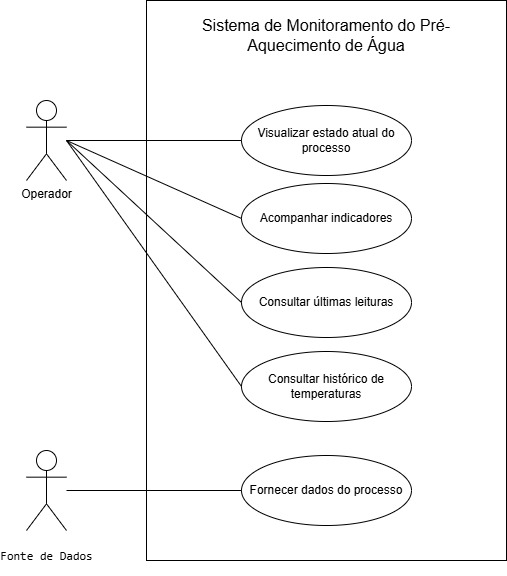

# Requisitos e regras de negócio

**Projeto:** Sistema de Monitoramento do Pré-Aquecimento de Água Industrial
**Base acadêmica:** TCC de Jean Koerich, UNIDAVI, 2026 — capítulo 4, Quadros 6, 7 e 8 (páginas 38–40 do PDF).
**Base de implementação:** `node-red/flows/flows.json`, versão consolidada em `a1703be`, mais a validação executada no Raspberry Pi em 23/11/2026.

Este documento diferencia **o requisito especificado no TCC** da **capacidade efetivamente demonstrada pela implementação**. A avaliação não substitui um teste de aceitação formal de todos os requisitos.

## 1. Escopo funcional

O sistema é uma aplicação de **monitoramento e análise de dados** de um processo térmico industrial. Não atua nas válvulas, bombas ou CLP: recebe ou simula leituras, detecta inconsistências, calcula indicadores, registra resultados e os apresenta por meio de uma interface web.

O operador pode visualizar o estado atual, acompanhar os indicadores, consultar leituras recentes e o histórico das temperaturas. A fonte efetivamente utilizada nesta versão é o **simulador do Node-RED**; existe um adaptador de mensagens para integração futura de um CLP.

## 2. Regras de negócio (RN01–RN15)

O Quadro 6 do TCC estabelece 15 regras. A tabela abaixo as sintetiza e relaciona aos componentes atuais:

| ID | Regra especificada | Tratamento na versão atual |
| --- | --- | --- |
| RN01 | Aceitar origem simulada ou de CLP virtual. | **Parcial:** F1 simula os dados; F2 adapta `msg.payload`, mas não existe aquisição Siemens conectada e F0 seleciona `simulado` por padrão. |
| RN02 | Padronizar o formato dos dados independentemente da origem. | **Implementada no software:** F3 normaliza campos; F4 valida o contrato. Integração real com CLP não testada. |
| RN03 | Representar `RECARREGANDO`, `AQUECENDO`, `MATURANDO` e `TRANSFERINDO`. | **Implementada no simulador:** F1 gera os quatro estados; F6 os classifica. |
| RN04 | Na recarga, entrada aberta e saída fechada. | F1 gera a condição; F4 a verifica. |
| RN05 | No aquecimento, duas válvulas fechadas e ausência de vazão. | F1 gera a condição; F4 verifica vazão incompatível. |
| RN06 | Após alcançar o limite de liberação, aguardar maturação. | F1 utiliza temperatura de liberação e período de maturação simulados. |
| RN07 | Na transferência, duas válvulas abertas e presença de vazão. | F1 gera a condição; F4 verifica inconsistências. |
| RN08 | Transferir somente após atingir a temperatura mínima. | **Modelada no simulador:** a passagem para maturação depende do limite; não é um intertravamento físico de CLP. |
| RN09 | Respeitar o limite máximo de segurança da água. | F1 limita a temperatura simulada; F6 também possui classificação de criticidade, com limiar próprio. |
| RN10 | Alertar ou bloquear leituras ausentes e inválidas. | F4 define `OK`, `ALERTA` ou `ERRO` e bloqueia dados críticos. |
| RN11 | Detectar fluxo em `AQUECENDO` ou `MATURANDO`. | F4 emite alerta quando a vazão supera o limite de referência. |
| RN12 | Detectar transferência sem fluxo. | F4 e F6 verificam a condição. |
| RN13 | Persistir apenas leituras tratadas e validadas. | F4 bloqueia erro; F5, F6, F7 e F8 exigem etapas anteriores para prosseguir. |
| RN14 | Controlar acumuladores de volume e energia por período. | F5 usa a data local do Node-RED e contexto para acumulados diários. Persistência do contexto foi testada no Raspberry Pi. |
| RN15 | Expor dados ao frontend por API, sem acesso direto ao banco. | API REST no Node-RED lê PostgreSQL; dashboard usa `/api/`. |

> **Importante:** os estados e atuadores da tabela representam **valores simulados ou monitorados**, não comandos executados pelo sistema sobre hardware industrial.

## 3. Requisitos funcionais (RF01–RF15)

Os identificadores são os utilizados no Quadro 7 do TCC.

| ID | Descrição resumida | Componente | Evidência / ressalva |
| --- | --- | --- | --- |
| RF01 | Selecionar origem das leituras. | F0 + Switch + F1/F2 | Seletor existe; origem atual definida no código como `simulado`. CLP não integrado. |
| RF02 | Receber variáveis de temperatura, vazão, estado, nível e válvulas. | F1/F2 | Dados simulados entregam os campos esperados; F2 recebe uma mensagem já adquirida. |
| RF03 | Normalizar os dados recebidos. | F3 | Conversão de valores numéricos, origem, timestamp, estados e válvulas. |
| RF04 | Validar as leituras. | F4 | Verifica obrigatoriedade, tipo, faixa e consistência. |
| RF05 | Identificar inconsistências operacionais. | F4/F6 | Alertas de vazão, válvulas e condições térmicas. |
| RF06 | Calcular diferença de temperatura. | F5 | `delta_t = max(0, T_saida - T_entrada)`. |
| RF07 | Calcular volume instantâneo. | F5 | Vazão × intervalo nominal de um minuto. |
| RF08 | Acumular volume. | F5 | Acumulador por dia local do processamento. |
| RF09 | Calcular energia térmica. | F5 | Estimativa por massa, calor específico e ΔT. |
| RF10 | Converter energia para kWh. | F5 | `energia_kj / 3600`. |
| RF11 | Acumular energia. | F5 | Soma diária no contexto. Não equivale necessariamente à energia útil transferida. |
| RF12 | Calcular desempenho térmico e economia estimada. | Tarifa + F5 | Percentual relativo ao ΔT de referência; estimativa monetária, não medição financeira. |
| RF13 | Classificar o processo. | F6 | Estado, condição térmica, transferência, desempenho, válvulas e criticidade. |
| RF14 | Armazenar leituras válidas. | F7 + F8 + PostgreSQL | `INSERT` com 29 parâmetros em `public.leitura_monitoramento`; gravação real verificada. |
| RF15 | Disponibilizar status, últimas leituras e histórico em API. | API F1–F6 | Três endpoints GET retornaram dados do PostgreSQL em teste real. |

Os requisitos RF01 e RF02 estão **contemplados para o modo simulado**, mas não devem ser apresentados como prova de aquisição industrial em tempo real.

## 4. Requisitos não funcionais (RNF01–RNF10)

Os itens abaixo reproduzem os **objetivos não funcionais** do Quadro 8 e indicam a evidência disponível, quando existe.

| ID | Requisito | Evidência atual / limite |
| --- | --- | --- |
| RNF01 | Executar em Raspberry Pi. | **Validado:** Raspberry Pi 5 utilizado como servidor local. |
| RNF02 | Operar continuamente durante o monitoramento. | **Evidenciado:** histórico contínuo registrado no período acadêmico; não constitui SLA nem ensaio prolongado de disponibilidade. |
| RNF03 | Inicializar serviços automaticamente. | **Validado no TCC:** Node-RED, PostgreSQL e Nginx voltaram após reinicialização do Raspberry Pi. |
| RNF04 | Recuperar operação após queda de alimentação elétrica. | **Parcial:** há evidência de reinicialização controlada, não um ensaio documentado de interrupção abrupta de energia. |
| RNF05 | Consumir poucos recursos. | **Sem medição quantitativa publicada:** execução no Raspberry Pi não substitui métricas de CPU, RAM, I/O e capacidade. |
| RNF06 | Manter módulos independentes. | **Implementado:** subfluxos e API REST separados. |
| RNF07 | Facilitar manutenção e evolução. | **Implementado em estrutura:** fluxos modularizados e cópias `.js` das funções; não há métrica formal de manutenibilidade. |
| RNF08 | Operar sem dependência de internet. | **Compatível com a arquitetura local:** processamento e banco no Raspberry Pi; teste de indisponibilidade da internet não foi demonstrado separadamente. |
| RNF09 | Restringir acessos administrativos. | **Parcial:** o TCC relata usuário administrativo no editor; os endpoints GET do fluxo não têm autenticação própria. |
| RNF10 | Não interromper aquisição se a interface ficar indisponível. | **Sustentado pela arquitetura:** API e dashboard são separados do processamento; não há teste de falha da interface anexado nesta revisão. |

## 5. Critérios de aceitação sugeridos para evolução

Estas são **sugestões de testes futuros**, e não alegações de que já foram executados:

1. Injetar um payload de CLP simulado pelo adaptador F2 e verificar normalização, persistência e exibição, sem exigir conexão Siemens real.
2. Injetar leituras inválidas e verificar o bloqueio por F4, sem gravar registros indevidos.
3. Verificar os quatro estados de F1 e a coerência entre válvulas, vazão e ciclo.
4. Desabilitar o servidor web e confirmar que a persistência continua.
5. Reiniciar o Node-RED com `localfilesystem` habilitado e verificar a recuperação de acumuladores.
6. Realizar testes de consumo de recursos, falhas abruptas e exposição de serviços em um ambiente de testes isolado.

## 6. Documentos relacionados

- [Arquitetura do sistema](arquitetura.md)
- [Indicadores e premissas](indicadores.md)
- [Contratos da API](api.md)
- [Testes e evidências](validacao.md)

**Fonte acadêmica:** TCC *Desenvolvimento de um Sistema de Monitoramento de Pré-Aquecimento de Água Industrial*, Jean Koerich, UNIDAVI, 2026, seções 4.2, 4.3, 4.4 e 4.19. As observações de implementação usam o export revisado do Node-RED e a validação de 23/11/2026.
